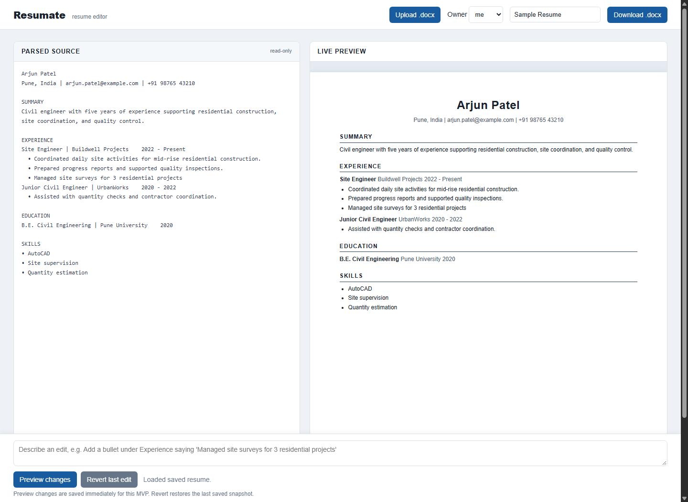

# Resumate

A deliberately small, single-port resume editor for turning Word resumes into a structured model, accepting natural-language edits, and exporting clean Word documents again.

## Start it

1. Copy `.env.example` to `.env` and set `GEMINI_API_KEY`. The default model is `gemini-2.5-flash-lite`; override it with `GEMINI_MODEL` only if needed. The app still works without a key for explicit offline requests such as “add a bullet under Experience saying …” and “add a Projects section after Education”. Rephrasing needs a Gemini key.
2. Run `make dev`.
3. Open <http://localhost:8000>, upload [`samples/sample_resume.docx`](samples/sample_resume.docx), and edit it.
4. To share the running app, run `make tunnel` in another terminal. The only exposed port is FastAPI; SQLite remains a bind-mounted local file.

The database is created automatically at `data/resume.db`. `GET /healthz` returns `{"ok": true}`.

## What is stored

`resumes.data` contains the canonical Pydantic `Resume` JSON. A `.docx` is generated from that model for export, never used as a database source after upload. Each successful `POST /edit` atomically updates the resume and writes one `edits` audit row containing before/after snapshots. The Revert button restores the snapshot from the latest edit.

## API

- `POST /upload` multipart fields: `file`, optional `owner` (`me` or `friend`)
- `GET /resumes` and `GET /resumes/{id}`
- `POST /edit` `{ "resume_id", "instruction" }`
- `POST /revert` `{ "resume_id" }`
- `POST /export` `{ "resume_id" }` returns a Word blob
- `GET /healthz`

## Design choices and limitations

- The repository interface isolates SQLAlchemy and SQLite inside `backend/repositories/resume_repo.py`; services and routes only work with the Pydantic model. Replacing it with Postgres is contained to that module.
- The Gemini client is behind an interface (`LLMClient`) in `services/llm.py`. It uses Gemini structured output with the Pydantic `Resume` schema, plus a prompt requiring minimal changes, stable existing IDs, and no invented facts. Validation ensures output matches the Resume schema. Provider errors deliberately fall back to a narrow local patcher rather than risking a failed request.
- Word parsing is intentionally heuristic: it recognizes Word heading styles and common résumé section names. It preserves content well for conventional single-column resumes but does not reproduce complex layouts, text boxes, columns, or original formatting. Export uses a clean normalized resume style.
- The UI’s “Preview changes” saves immediately so that the specified `/edit` audit behavior remains simple and reliable. The prior version is one click away through Revert.
- SQLite is ideal for these two users but is a single-writer database. Do not expose `data/` or the SQLite file through a web server.

## Development notes

Source is under `backend/`; Docker bind-mounts it for Uvicorn reload. Dependencies are intentionally limited to FastAPI, Uvicorn, python-docx, Pydantic, SQLAlchemy, OpenAI, and multipart form support. No authentication is included for this MVP, so protect the ngrok URL appropriately.
